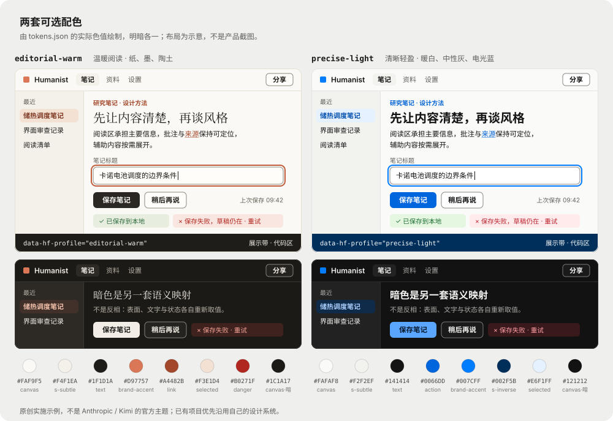
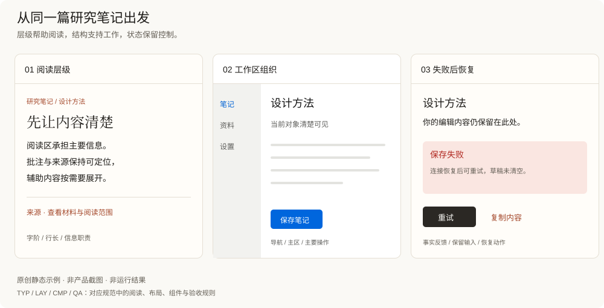

<h1 align="center">Humanist</h1>

<p align="center"><b>简体中文</b> · <a href="README.en.md">English</a></p>

<p align="center">从 Anthropic 与 Kimi 公开设计资料提炼的中文前端设计规范和 Agent Skill，覆盖中文排版、保存恢复、长任务状态这类容易做错的细节。</p>

<p align="center"></p>

```bash
npx skills add Hai-qq/humanist-frontend
```

## 它针对的问题

下面是写中文界面时常见的五种翻车，规范里都有对应条目：

| 翻车场景 | 规范要求 | 规则 |
|---|---|---|
| 用中文输入法选词时按回车，消息被直接发了出去 | 组合输入进行中，Enter 不能触发提交；处理 compositionstart / compositionend，注意框架合成事件与 nativeEvent 的区别 | [CMP-02](DESIGN_SPEC.md#cmp-02--输入保存与反馈)<br>[CMP-05](DESIGN_SPEC.md#cmp-05--输入建议与执行动作分开) |
| 保存其实失败了，界面却显示“已保存”；刷新后草稿没了 | 区分未保存、保存中、已保存、失败；不在 `setTimeout` 后无条件显示“已保存”；失败时说明输入是否保留、能否重试 | [CMP-02](DESIGN_SPEC.md#cmp-02--输入保存与反馈) |
| 点了“停止”，界面写着已停止，后台任务还在跑 | “停止显示输出”和“取消执行”分开；取消先进入 cancelling，收到执行端确认才显示 cancelled | [AGT-04](DESIGN_SPEC.md#agt-04--快速结果不是取消任务的别名)<br>[AGT-01](DESIGN_SPEC.md#agt-01--长任务有可理解的状态模型) |
| 中文正文照搬英文的行高、字距和全大写标签 | 中文正文默认不加字距、不套 ALL CAPS；阅读正文行高从 1.7 起，阅读栏先试 32–42em，再用真实内容检验 | [TYP-02](DESIGN_SPEC.md#typ-02--中文不能套用英文字体微调)<br>[TYP-01](DESIGN_SPEC.md#typ-01--字体按职责选择) |
| 自动生成的标题，覆盖了用户刚改好的名字 | 正文保存与标题生成可以各自失败；用户手动改名后，迟到的生成结果不能覆盖；对象已切换或删除时丢弃旧结果 | [CMP-04](DESIGN_SPEC.md#cmp-04--自动命名是可编辑的辅助元数据) |

规范共 42 条规则，按目标与证据（CTX）、视觉与排版（VIS、TYP、LAY）、组件与长任务（CMP、AGT）、实施流程（RUN）、可访问性与验收（A11Y、QA）等分组，每条写明依据、适用条件和检查方法。全文见 [DESIGN_SPEC.md](DESIGN_SPEC.md)。



上图把这些规则放进同一个“整理研究笔记”的界面：阅读层级、工作区组织、保存失败与恢复。[示例说明](docs/EXAMPLES.md)

## 安装

Skill 是一个完整目录（`SKILL.md` 入口加 references、assets、templates、scripts），任选一种方式装进项目。

**skills CLI**（Claude Code、Codex、Cursor 等，需要 Node.js）

```bash
npx skills add Hai-qq/humanist-frontend
```

默认装在当前项目并询问装给哪些 Agent；`-a claude-code` 指定 Agent，`-g` 装到用户目录。CLI 由 [vercel-labs/skills](https://github.com/vercel-labs/skills) 提供。

**Claude Code 插件**

```text
/plugin marketplace add Hai-qq/humanist-frontend
/plugin install humanist-frontend@humanist-frontend
```

**Python 安装器**（不需要 Node.js，支持 Codex、Claude Code、Kimi）

```bash
git clone https://github.com/Hai-qq/humanist-frontend.git
python3 humanist-frontend/scripts/install_skill.py --host claude --project /path/to/project
```

`--host` 可选 `codex`、`claude`、`kimi`；安装器只复制文件，不覆盖已有 Skill。升级、手工复制和各宿主目录见[安装与升级](docs/INSTALL.md)。

## 怎么用

装好后在任务里点名即可，例如：

```text
使用 humanist-frontend，为当前研究笔记项目改进阅读与保存体验。
沿用现有主题，先确定内容层级与状态问题，再实现相关改动。
检查中文长文本、保存失败与恢复，说明哪些行为尚未验证。
```

不装也能用：直接读[设计规范](DESIGN_SPEC.md)，或挑出相关规则，按[项目模板](skills/humanist-frontend/templates/DESIGN.template.md)写进自己项目的设计约定。已有设计系统时，以项目自己的系统为准。

## 资料与文档

| 想了解 | 看这里 |
|---|---|
| 规则全文：原则、理由、适用条件、检查方法 | [设计规范](DESIGN_SPEC.md) |
| 读了哪些材料、读到哪里 | [来源导读](research/READING_GUIDE.md) · [完整台账](research/SOURCE_AUDIT.md) |
| 为什么采用、调整或放弃某种做法 | [证据与决策](research/EVIDENCE_AND_DECISIONS.md) |
| Agent 怎样按任务挑规则 | [Skill 入口](skills/humanist-frontend/SKILL.md) |
| 配色变量 | [Token 使用](docs/TOKENS.md) |
| 开发、检查与评估 | [开发与检查](docs/DEVELOPMENT.md) · [验证记录](reports/VALIDATION.md) · [评估协议](evals/README.md) |

## 证据边界

- 这是个人整理的研究笔记和规范，不是 Anthropic 或 Kimi 的官方规范，也不是两家共同发布的统一系统，与两家公司没有隶属关系。
- 规范分别标明三类内容：来源事实、作者的综合判断、原创的实施默认值。
- 来源台账共 50 条记录，包含基础技术资料、节选和共同来源，不等于读完了 50 份独立的完整材料；两段完整访谈仍未取得完整转录。来源快照为 2026-09-08，之后没有重新核验全部外部来源。
- 两套配色和示例图都是原创示例，不是两家的官方主题或产品截图，也不是已实现应用的测试结果。
- 仓库自带的检查覆盖生成物同步、本地链接、来源与规则追踪、安装复制、归档清单，以及 92 个声明的纯色色对，共 47 项单元测试，见[验证记录](reports/VALIDATION.md)。
- 尚未执行：18 个 Agent 评估场景、宿主实机加载、下游页面的视觉与交互、真实系统输入法、读屏和整页 WCAG 验收。所以本项目不宣称“用了界面会更好”。

在真实项目里遇到规则不管用或出错的情况，欢迎[提交反馈](https://github.com/Hai-qq/humanist-frontend/issues/new)。补充依据和规则的方式见[贡献约定](CONTRIBUTING.md)。

---

<p align="center"></p>

<p align="center">
  <a href="https://github.com/Hai-qq/humanist-frontend/actions/workflows/validate.yml"></a>
  <a href="LICENSE"></a>
  <a href="https://github.com/Hai-qq/humanist-frontend/releases"></a>
</p>

展示名称为 **Humanist · 界面设计札记**；仓库、安装目录和调用名保持 `humanist-frontend`。[更新记录](CHANGELOG.md) · [视觉标识](docs/BRAND.md) · [社区约定](CODE_OF_CONDUCT.md) · [安全报告](SECURITY.md)

原创部分采用 [MIT License](LICENSE)。第三方名称、资料与素材范围见 [THIRD_PARTY_NOTICES](THIRD_PARTY_NOTICES.md)。
